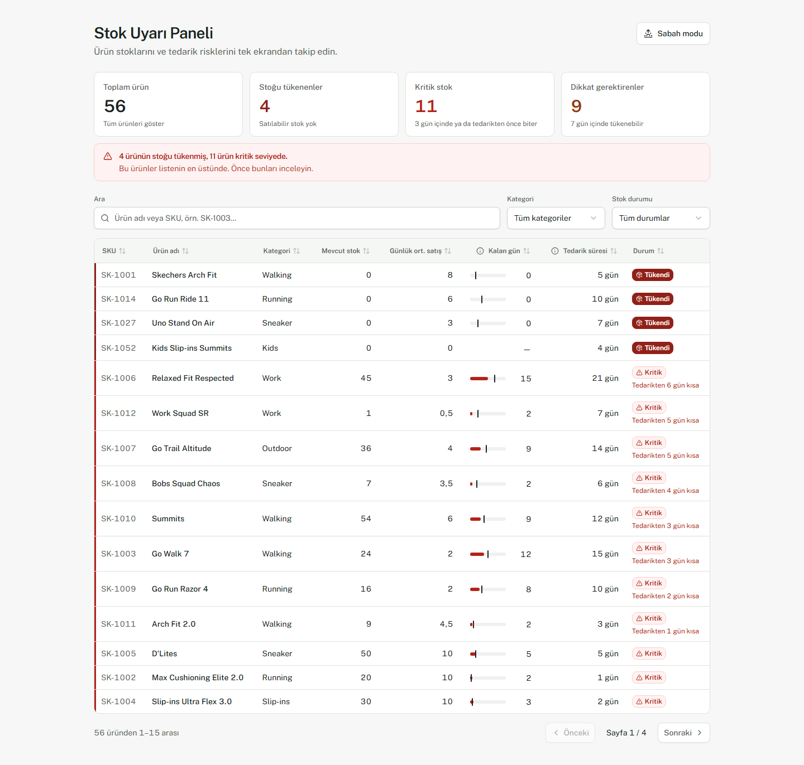

# Stok Uyarı Paneli (POC)

Ayakkabı mağazası müdürünün stoğu tükenen, kritik seviyedeki ve tedarik süresi nedeniyle risk altındaki ürünleri tek ekranda görmesini sağlayan karar destek paneli. Veri bir JSON dosyasından okunur. Backend, veritabanı ve kullanıcı girişi yoktur.



## Çalıştırma

Gereksinim: Node.js 20 veya üzeri (geliştirme Node 24 ile yapıldı).

```bash
npm install
npm run dev          # http://127.0.0.1:5173
```

| Komut | Ne yapar |
|---|---|
| `npm run dev` | Geliştirme sunucusunu başlatır |
| `npm test` | İş kuralı birim testleri (Vitest) |
| `npm run test:e2e` | Tarayıcı kabul testleri (Playwright, masaüstü + mobil) |
| `npm run build` | Tip kontrolü + üretim derlemesi (`dist/`) |
| `npm run preview` | Derlenmiş sürümü yerelde sunar |

Playwright ilk kez çalıştırılacaksa tarayıcıyı kurun: `npx playwright install chromium`.

## Veri

Ürünler [public/data/products.json](public/data/products.json) dosyasından okunur (56 demo ürün). Dosyayı değiştirip sayfayı yenilemek yeterlidir.

```json
{ "sku": "SK-1001", "name": "Skechers Arch Fit", "category": "Walking",
  "stock": 24, "dailyAverageSales": 8, "leadTimeDays": 5 }
```

Hatalı kayıtlar sıfıra çevrilmez. Tablo ve özet sayılarının dışında tutulur ve sayfada satır numarası, SKU ve nedenle birlikte listelenir. Dosya tamamen bozuksa panel çökmez, anlaşılır bir hata mesajı gösterir.

## İş kuralları

| Kural | Uygulama |
|---|---|
| Kalan gün | `stock / dailyAverageSales`. Satış 0 ise hesaplanmaz. |
| Tedarik açığı | `leadTimeDays − remainingDays`. Pozitifse yeni stok gelmeden ürün tükenir. |
| Durum (sırayla) | Tükendi (`stock = 0`) → Satış Yok (`satış = 0`) → Kritik (`kalan ≤ 3` veya `kalan ≤ tedarik`) → Dikkat (`kalan ≤ 7`) → Normal |
| Öncelik | Tükendi, Kritik, Dikkat, Normal, Satış Yok. Kritik içinde tedarik açığı büyükten küçüğe, eşitlikte kalan gün kısa olan önce. Diğerlerinde kalan gün kısa olan önce. |

Karşılaştırmalar yuvarlanmamış değerlerle yapılır. Yuvarlama yalnızca ekranda uygulanır (1 ondalık).

## Mimari

```
src/
  domain/      İş kuralları: saf TypeScript, UI'dan bağımsız, birim testli
    calculate.ts   kalan gün, tedarik açığı, durum
    prioritize.ts  aciliyet sıralaması
    validate.ts    JSON kayıt doğrulama
    summarize.ts   KPI ve uyarı metni
    search.ts      Türkçe harf duyarsız arama
  data/        JSON yükleme (hiçbir durumda fırlatmaz)
  components/  React + shadcn/ui; TanStack Table yalnızca tablo durumunu yönetir
  lib/         Biçimlendirme (tr-TR), durum etiketleri
e2e/           Playwright kabul testleri
docs/          Tasarım planı, kabul kriterleri, kapsam, sunum özeti
```

Teknoloji: React 19, TypeScript, Vite 8, Tailwind CSS 4, shadcn/ui (Card, Badge, Table, Input, Select, Tooltip, Alert, Button), TanStack Table 9, Lucide, Vitest, Playwright.

## Dokümanlar

- [Kabul kriterleri kontrol listesi](docs/KABUL_KRITERLERI.md)
- [Kapsam ve varsayımlar](docs/KAPSAM_VE_VARSAYIMLAR.md)
- [Sunum özeti](docs/SUNUM_OZETI.md)
- [Tasarım ve geliştirme planı](docs/TASARIM_VE_PLAN.md)
